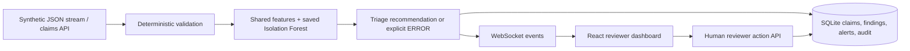

# ClaimGuard submission preparation

## Current evidence and remaining gate

Local Windows AMD64 and IBM LinuxONE s390x workflows are verified. Remote evidence is in [evidence/linuxone](../evidence/linuxone/linuxone-verification.json); 34 tests passed on the target, a trained model scored claims there, and the local dashboard displayed the remote evidence through an SSH tunnel. Final recorded presentation and official submission remain pending. Do not describe the MVP as fully complete. The report is [local-verification.json](../evidence/local-verification.json). It records the workload, actual runtime architecture, timings, 100 delivered WebSocket events, and a synthetic verification disposition. The browser reload screenshot is [reviewer-reload.png](../evidence/reviewer-reload.png).

No real patient data, production insurer credentials, or real submissions are used. An anomaly is evidence for human investigation, never a fraud accusation or automatic denial. The score is a triage priority, not a calibrated probability.

## Architecture

The final deployment must execute M on the actual event-provided LinuxONE VM. A configured IBM_LINUXONE label or diagram alone is not deployment evidence.

## Local measured results

100 serial HTTP claims, concurrency 1, no warmup, one fixed provider/procedure, unique synthetic patients, amounts $350–449. These inputs are a simple test workload, not representative healthcare traffic. Timings include host load and instrumentation overhead.

| Metric | Mean | Median | p95 |
|---|---:|---:|---:|
| Scoring path (features, model calls and evidence construction) | 46.647 ms | 37.716 ms | 102.194 ms |
| End-to-end HTTP ingestion | 83.818 ms | 65.346 ms | 165.249 ms |

Serial request throughput: 11.909 claims/s. Separate 100-claim generator stream: 41.792 s, 2.393 claims/s, with configured 0.1 s pacing plus processing and WebSocket delivery. This is observed paced throughput, not maximum system capacity. The stream produced 82 READY, 6 CORRECTION and 12 REVIEW recommendations, not ground-truth accuracy counts.

## Two-minute demonstration script

| Time | Action and narration |
|---|---|
| 0:00–0:20 | Show landing screen. “ClaimGuard checks synthetic claims before onward submission, separates missing information from unusual patterns, and keeps the final decision with a reviewer.” Open dashboard. |
| 0:20–0:50 | Start Synthetic Stream. Show claims appearing through the live connection. The UI's default stream is 100 claims at 1 s pacing plus processing; it continues while explaining the next steps. For a faster rehearsal, the existing API supports count=100 and delay=0.1. |
| 0:50–1:20 | Select a REVIEW claim with a high amount. Explain the distinct deterministic findings, model evidence and triage priority. Mention that scenario labels do not influence model inference. |
| 1:20–1:40 | Record a human disposition for this synthetic claim. Reload, reselect it, and show the saved decision. Use the claim detail API to show the corresponding reviewer audit event. |
| 1:40–2:00 | Once deployed, show actual LinuxONE provisioning/architecture evidence, the running service and measured remote report. Until then, explicitly say “local demonstration; LinuxONE deployment pending” and show only the local report. |

## Reproduce and finalize

- Local backend: `python -m uvicorn backend.main:app --host 127.0.0.1 --port 8000`.
- Tests: `python -m pytest -q`. Frontend: `npm run build` and `npm run dev`.
- Verification workload: `python -m scripts.verify_demo`. It creates 200 synthetic claims (100 serial HTTP measurements plus the separate 100-claim stream) and records one labelled verification disposition. It writes `evidence/local-verification.json`; use `--output` to retain separate runs.
- Follow [LINUXONE.md](LINUXONE.md) for access, architecture verification, deployment and remote evidence.
- Before submitting: replace the pending deployment status only after successful remote scoring and tests; include remote timing conditions, deployment logs, demo recording and applicable official event submission requirements.

## Limitations

Training uses generated feature vectors, not verified real claims distributions. Provider/procedure hashing is reproducible but has collisions. Amount/line deviations are descriptive heuristics, not validated causal attributions. No calibrated fraud probability, real-world accuracy, held-out false-positive estimate or fairness evaluation is established. LinuxONE timing evidence is documented below. Local routing tests and timing measurements do not establish these properties. X12 parsing and real insurer integration are outside this build.

## Verified LinuxONE measurements — 18 October 2026

Ubuntu 24.04, Python 3.12.3, s390x, AI_LAB provisioned as 3 vCPUs / 8 GB. Native target model trained with scikit-learn 1.4.1.post1; do not compare its timing as an identical-runtime speedup against Windows scikit-learn 1.8.0.

| Metric | Mean | Median | p95 |
|---|---:|---:|---:|
| Target scoring path | 2.679 ms | 2.189 ms | 2.582 ms |
| Target loopback HTTP ingestion | 11.953 ms | 10.897 ms | 17.374 ms |

100 serial HTTP requests, concurrency 1, no warmup, unique synthetic patients, amounts $350–449. Observed serial throughput: 83.458 claims/s. Separate paced 100-event stream: 11.916 s, 8.392 claims/s. This is not a maximum-throughput benchmark and excludes internet/tunnel latency. The stream reused prior seeded profiles in the same database: 94 REVIEW and 6 CORRECTION include duplicate findings, not model-quality labels. All 100 events arrived and the verification disposition persisted. The mean scoring time exceeds p95 because a few long outliers affect the mean.

[Remote report](../evidence/linuxone/linuxone-verification.json), [tests](../evidence/linuxone/tests.log), [service log](../evidence/linuxone/service.log), [package versions](../evidence/linuxone/linuxone-packages.txt), [dashboard proof](../evidence/linuxone/dashboard.png). The remote report replaces the earlier pending deployment status; neither local nor remote runs establish real-world fraud performance. The public Vercel app now connects through HTTPS/WSS without a local tunnel. API and approved web-port startup units are enabled; process-failure recovery passed, while a full VM reboot remains untested.
Repository copies of terminal logs have normalized line endings and trailing whitespace for readability; original logs remain on the VM. Recorded results are unchanged.
